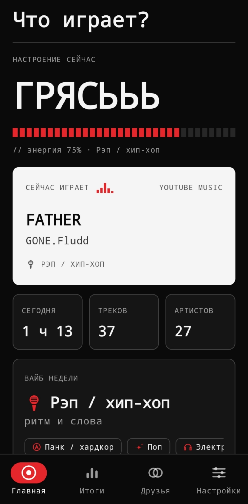
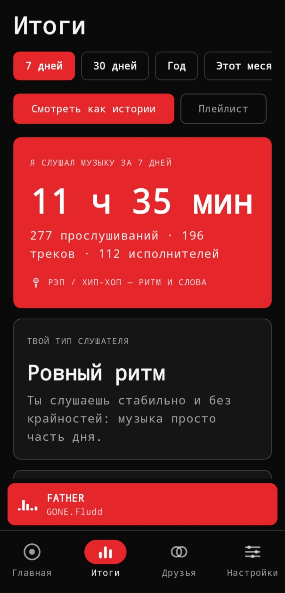
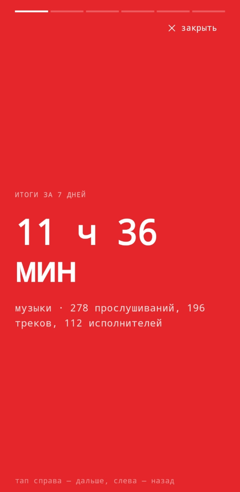
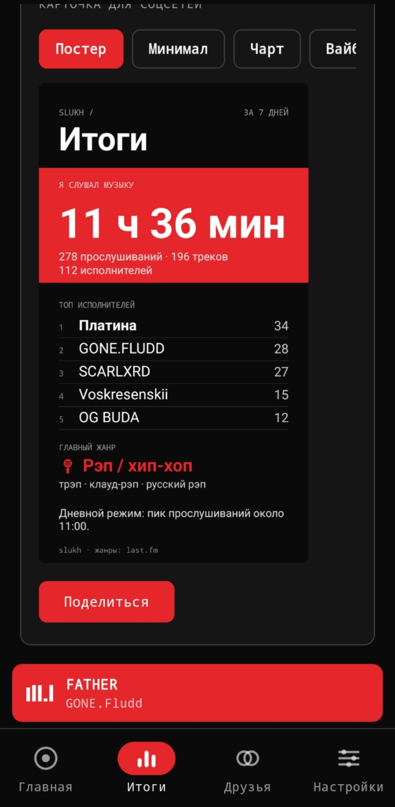
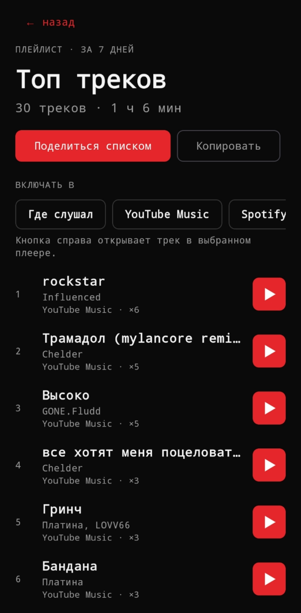
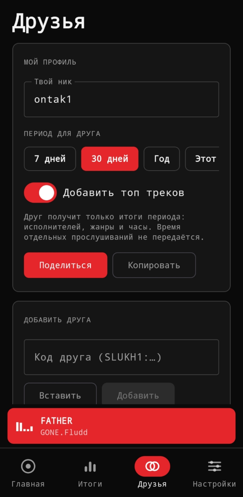

<div align="center">


# Slukh

**Статистика прослушивания музыки для Android: любой плеер, без аккаунтов, всё хранится на твоём телефоне.**


</div>

> **English TL;DR.** Slukh is a privacy-first Android app that tracks what you listen to in *any* music player
> (YouTube Music, VK Music, Spotify, local files, ...) by reading media sessions through the notification
> listener API. Everything is stored locally in SQLite. It builds recaps (week / month / year / calendar month),
> Instagram-style stories, shareable cards, a "top tracks" playlist, genre statistics (via your own free
> Last.fm API key) and lets you compare tastes with friends through a copy-paste code, no server involved.
> The UI is currently Russian only. Build instructions are in [Сборка из исходников](#сборка-из-исходников).

---

## Содержание

1. [Что это](#что-это)
2. [Возможности](#возможности)
3. [Скриншоты](#скриншоты)
4. [Как это работает](#как-это-работает)
5. [Приватность и данные](#приватность-и-данные)
6. [Поддерживаемые плееры](#поддерживаемые-плееры)
7. [Установка и первый запуск](#установка-и-первый-запуск)
8. [Жанры и ключ Last.fm](#жанры-и-ключ-lastfm)
9. [Друзья: как устроен обмен профилем](#друзья-как-устроен-обмен-профилем)
10. [Сборка из исходников](#сборка-из-исходников)
11. [Структура проекта](#структура-проекта)
12. [База данных](#база-данных)
13. [Резервная копия и восстановление](#резервная-копия-и-восстановление)
14. [Как расширять приложение](#как-расширять-приложение)
15. [Известные ограничения](#известные-ограничения)
16. [Планы](#планы)
17. [Участие в проекте](#участие-в-проекте)
18. [Лицензия](#лицензия)
19. [Благодарности и отказ от ответственности](#благодарности-и-отказ-от-ответственности)

---

## Что это

Slukh (от «слух») записывает всё, что ты слушаешь на телефоне, и превращает это в статистику, которую
приятно смотреть и показывать друзьям: сколько часов музыки, кто твой главный исполнитель, какой жанр
играл больше всего, в какое время суток ты слушаешь, какой ты тип слушателя.

Главное отличие от похожих сервисов: приложению **не нужны аккаунты стриминговых сервисов**. Оно не ходит
в API Spotify или YouTube. Вместо этого оно читает то, что Android и так знает о воспроизведении
(название трека, исполнитель, состояние плеера), поэтому работает с любым плеером, включая VK Музыку,
YouTube Music и его модифицированные сборки, Telegram, локальные плееры и всё, что умеет показывать
плеер в шторке уведомлений.

**Принципы:**

- без регистрации и без собственных серверов;
- вся история лежит только на устройстве;
- в интернет уходят только имена исполнителей, и только если ты сам подключил определение жанров;
- нет сторонних библиотек, кроме AndroidX (Jetpack Compose, Material 3).

## Возможности

### Главная

- **Что играет сейчас** с карточкой трека и плеера.
- **Настроение** (от «спокойствие» до «драйв на максимум»): считается по жанрам последних прослушиваний
  и времени суток.
- Плитки за сегодня: время, число треков, число исполнителей.
- **Вайб недели**: главный жанр недели с иконкой и подписью, остальные жанры чипами.
- **Достижения** (12 штук): от «Первый шаг» до «Месяц ритма» и «Марафонец».
- Недавно сыгранное (последние 8 треков).
- Мини-плеер внизу на других вкладках, если что-то играет.

### Итоги

Периоды: **7 дней**, **30 дней**, **год**, **этот календарный месяц**, **прошлый календарный месяц**
(на карточках пишется название месяца).

- Общее время, число прослушиваний, треков и исполнителей.
- Топ исполнителей, топ треков, жанры и поджанры с полосами долей.
- **Факты**: серия дней подряд, дней с музыкой, новые исполнители, любимый час, доля повторов,
  музыки в день, динамика к прошлому периоду, самый длинный трек, будни против выходных, день против ночи,
  доля главного исполнителя, «гимн периода», самый музыкальный день и другое.
- **Тип слушателя**: Ночная сова, Верный фанат, Исследователь, Жанровый хамелеон, Утренний заряд,
  Ровный ритм.
- **«За это время ты мог бы…»**: время музыки, переведённое в фильмы, марафоны, пельмени и борщ.
- Редактирование жанра и поджанров исполнителя: выбор из готовых вариантов или свой.

### Истории

Итоги в формате сторис: тап справа вперёд, слева назад. Фон чередуется (акцент, инверсия, обычный),
на странице жанра показывается его иконка.

### Карточки для соцсетей

PNG 1080×1920 в четырёх стилях:

| Стиль | Описание |
|---|---|
| **Постер** | тёмный фон и большой акцентный блок со временем |
| **Минимал** | светлая бумага, много воздуха, топ-3 и главный трек |
| **Чарт** | топ-5 исполнителей горизонтальными столбиками |
| **Вайб** | весь фон в цвет акцента, огромная иконка жанра, тип слушателя |

### Плейлист

Топ-30 треков за выбранный период с общей длительностью. Список можно скопировать или отправить текстом.
Кнопка у каждого трека открывает его в плеере (подробности в разделе [Поддерживаемые плееры](#поддерживаемые-плееры)).

### Друзья

Сравнение вкусов без сервера: ты отправляешь другу код своего профиля, он вставляет его в Slukh и видит
процент совпадения, общих исполнителей и жанры, сравнение времени и список «новое для тебя»
(см. [Друзья: как устроен обмен профилем](#друзья-как-устроен-обмен-профилем)).

### Оформление

- Тема: авто, светлая, тёмная.
- Четыре готовые палитры («Красный», «Кислота», «Лёд», «Сахар») и свой цвет акцента из сетки.
- Семь шрифтов.
- 15 однотонных иконок жанров, нарисованных векторами и красящихся в цвет акцента.

### Прочее

- Приветственные экраны для новых пользователей.
- Включение и отключение приложений, которые считаются музыкой (например, чтобы видео не попадало в статистику).
- Удаление всей истории одной кнопкой.
- **Резервная копия и восстановление** истории одним файлом, автокопия в выбранную папку раз в сутки.
- **Проверка обновлений**: приложение подсказывает, что на GitHub вышла новая версия.

## Скриншоты

|                      Главная                      | Итоги | Истории |
|:-------------------------------------------------:|:---:|:---:|
|  |  |  |

| Карточки | Плейлист | Друзья |
|:---:|:---:|:---:|
|  |  |  |

## Как это работает

### Откуда берутся данные

Приложение содержит `NotificationListenerService` (`MusicListenerService`). Получив у пользователя доступ
к уведомлениям, оно подписывается на активные **медиасессии** Android (`MediaSessionManager`).
Для каждой сессии сервис видит:

- название трека, исполнителя, альбом, длительность;
- состояние воспроизведения (играет или пауза);
- пакет приложения-плеера.

Тексты уведомлений и сообщений приложение **не читает**. Микрофон не используется.

### Когда прослушивание засчитывается

- Трек засчитывается, когда сыграна **половина длительности или 4 минуты** (что наступит раньше).
- Время на паузе не считается, учитывается реально проигранное время (`played_ms`).
- Длительность должна быть от **30 секунд до 15 минут**. Более короткие и длинные записи (голосовые сообщения,
  подкасты, миксы) не считаются музыкой.
- Приложения, перечисленные как видео (YouTube, ReVanced/Vanced YouTube, галереи), по умолчанию выключены.
  Любое приложение можно включить или отключить в настройках в разделе «Что считать музыкой».
- Голосовые и видеосообщения отфильтровываются по названию.
- **Реклама в плеерах** (например, вставки Spotify в бесплатной версии) не считается: такие записи распознаются по подписи «Advertisement» и аналогам на других языках и не попадают в статистику.

### Разбор названий (`TrackParser`)

Чтобы статистика не распадалась, названия приводятся в порядок:

- несколько исполнителей разделяются по `,`, `;`, `&`, `x`, `feat.`, `ft.`, `vs.`; исключения вроде
  «Tyler, the Creator» хранятся в списке `NO_SPLIT`;
- участники из скобок `(feat. ...)` добавляются к исполнителям;
- из названий убирается мусор: `(Official Video)`, `[Lyrics]`, `(Премьера клипа)`, `| канал`;
- для YouTube название вида «Артист - Песня» разбирается на исполнителя и трек;
- для сравнения используются нормализованные ключи (регистр, знаки препинания и «ё» не важны).

### Определение жанров

Жанры необязательны. Если подключён ключ Last.fm, для каждого нового исполнителя запрашиваются
пользовательские теги (`artist.getTopTags`). `GenreMapper` по набору правил сопоставляет теги
с одним из **15 жанров** и подбирает до трёх поджанров:

Рэп / хип-хоп · Поп · Рок · Инди / альтернатива · Метал · Панк / хардкор · Электроника · R&B / соул ·
Джаз / блюз · Классика · Фолк / кантри · Шансон / авторская песня · Регги / ска · Латино · Саундтрек.

Как это устроено:

- теги с весом меньше 10 игнорируются;
- запросы идут не чаще одного в секунду, в фоне, и безопасно возобновляются;
- если исполнитель не найден, повторная попытка будет через 7 дней;
- жанр, заданный вручную, никогда не перезаписывается автоопределением.

## Приватность и данные

| Что | Где хранится | Что уходит наружу |
|---|---|---|
| История прослушиваний | SQLite на устройстве | ничего |
| Настройки, ключ Last.fm, ник | `SharedPreferences` на устройстве | ничего |
| Жанры исполнителей | SQLite на устройстве | только **имя исполнителя** уходит в Last.fm, и только если подключён ключ |
| Профиль для друга | создаётся по кнопке | итоги периода уходят туда, куда ты сам их отправишь |
| Резервная копия | файл, который ты сохраняешь сам, или файл в выбранной тобой папке | ничего: файл не уходит никуда сам |
| Проверка обновлений | запрос списка релизов на `api.github.com` | никаких данных о тебе и о музыке; отключается в настройках |

- Названия треков и история прослушиваний в Last.fm не передаются.
- Нет аналитики, нет рекламы, нет собственного сервера.
- Доступ к уведомлениям можно отозвать в системных настройках Android в любой момент.
- Для обычных облачных бэкапов Android (`allowBackup`) учти, что в них попадают база и настройки,
  включая ключ Last.fm. При желании исключи их через правила в `res/xml/data_extraction_rules.xml`.

## Поддерживаемые плееры

**Подсчёт прослушиваний** работает с любым приложением, которое публикует медиасессию Android.
Проверено на YouTube Music (включая модификации ReVanced и RVX), VK Музыке и Spotify. Остальные плееры должны работать, но не проверялись.

**Кнопка «Включить»** (в плейлисте и у друзей). У Android нет единого способа «включить конкретный трек»,
поэтому Slukh пробует варианты по очереди:

1. Если плеер сейчас «живой» и заявляет, что умеет искать и играть, запрос отправляется в его медиасессию,
   как это делает голосовой помощник.
2. Иначе открывается поиск по запросу «исполнитель трек» внутри приложения.
3. Если приложение не понимает ссылку, открывается веб-версия или просто приложение.

| Плеер | Что получится |
|---|---|
| YouTube Music и модификации | поиск в приложении или в браузере, воспроизведение через сессию, если плеер активен |
| Spotify | открывается поиск по запросу; сам трек Spotify автоматически не включает |
| VK Музыка | открывается поиск по ссылке `vk.com/audio?q=`; работоспособность зависит от версии приложения |
| Яндекс Музыка | пробуется ссылка поиска; **не проверено** на реальном устройстве |
| Остальные | система предложит приложения, умеющие воспроизводить по поиску |

Плеер для кнопки можно выбрать на экране плейлиста: «Где слушал» (по умолчанию), YouTube Music, Spotify,
Яндекс Музыка или VK.

## Установка и первый запуск

1. Готовые сборки пока не публикуются: собери проект (см. [Сборка из исходников](#сборка-из-исходников)). Когда появятся релизы, APK можно будет скачать на вкладке **Releases**.
2. На приветственном экране выдай **доступ к уведомлениям** («Доступ к уведомлениям» в настройках Android).
   Без него приложение не видит, что играет.
3. По желанию подключи жанры (см. следующий раздел). Без ключа всё работает, кроме жанров.
4. Включи музыку. Первое прослушивание появится после того, как сыграна половина трека.

**Если прослушивания не записываются на Xiaomi, Samsung, Huawei и других прошивках с агрессивной
экономией батареи:** отключи для Slukh оптимизацию батареи и разреши работу в фоне, иначе система
может останавливать сервис.

## Жанры и ключ Last.fm

Last.fm требует личный API-ключ. Он бесплатный и выдаётся за пару минут:

1. В Slukh на карточке жанров нажми **«Открыть Last.fm»** (или перейди на `last.fm/api/account/create`).
2. Войди или зарегистрируйся.
3. В форме создания приложения вставь название и описание (в приложении есть кнопки «Копировать название»
   и «Копировать описание»). Тип использования выбери **некоммерческий**.
4. Скопируй показанный **API key** (32 символа из цифр и букв a–f) и вернись в Slukh: он найдёт ключ
   в буфере обмена и предложит его использовать. Можно вставить вручную.
5. Slukh проверит ключ тестовым запросом и начнёт определять жанры в фоне.

Ключ хранится только на телефоне. Его можно проверить или удалить на той же карточке.

> **Важно.** API Last.fm разрешён для некоммерческого использования. Если ты планируешь использовать
> проект в коммерческих целях, сначала изучи [условия API Last.fm](https://www.last.fm/api/tos).

## Друзья: как устроен обмен профилем

Серверов нет. Профиль превращается в текстовый **код** вида `SLUKH1:…`, который можно отправить
в любой мессенджер.

### Что внутри кода

Снимок профиля за выбранный период:

- ник (до 24 символов) и постоянный случайный идентификатор профиля;
- подпись периода, границы времени (`from`, `until`) и дата создания;
- итоги: время, число прослушиваний, треков, исполнителей;
- топ-20 исполнителей с числом прослушиваний, топ-8 жанров;
- по желанию топ-10 треков.

Время отдельных прослушиваний в код **не попадает**.

### Формат

```
SLUKH1: + base64url( gzip( JSON ) )
```

JSON содержит поле версии `"v": 1`. Код можно вставить в любое сообщение вместе с поясняющим текстом:
Slukh ищет шаблон `SLUKH1:...` внутри текста. Для разбора берутся только известные поля, длины строк и числа
записей ограничиваются, а размер после распаковки не превышает 256 КБ.

### Как считается совпадение

Slukh считает **твою** статистику за то же окно времени, за которое друг собрал снимок. Затем:

- *по исполнителям*: сумма меньших долей по общим исполнителям среди топ-20 с обеих сторон;
- *по жанрам*: то же для топ-8 жанров;
- итоговый процент: среднее двух значений.

Повторная отправка кода тем же человеком заменяет его прошлый снимок (по идентификатору профиля).

## Сборка из исходников

### Требования

- Актуальная стабильная **Android Studio**, поддерживающая Android Gradle Plugin **9.4.1**;
- **JDK 17** или новее (обычно встроенный в Android Studio JDK подходит);
- Android SDK Platform **37**;
- устройство или эмулятор с **Android 8.0 (API 26)** и новее.

### Версии

| Компонент | Версия |
|---|---|
| Android Gradle Plugin | 9.4.1 |
| Kotlin | 2.2.10 |
| Compose BOM | 2026.02.01 |
| `compileSdk` / `targetSdk` | 37 |
| `minSdk` | 26 |

### Шаги

```bash
git clone https://github.com/<твой-ник>/slukh.git
cd slukh
```

1. Открой папку проекта в Android Studio и дождись синхронизации Gradle.
2. Выбери устройство или эмулятор и нажми **Run**.

Из командной строки:

```bash
# Linux / macOS
./gradlew assembleDebug

# Windows
gradlew.bat assembleDebug
```

Готовый APK: `app/build/outputs/apk/debug/app-debug.apk`.

> Ключ Last.fm в проект **не зашивается**: каждый пользователь вводит свой в приложении. Никаких секретов
> для сборки не требуется.

### Релизная сборка

Для релиза нужна подпись. Создай keystore (`Build → Generate Signed Bundle / APK`) и **никогда не
добавляй его в репозиторий** (`*.jks` и `*.keystore` уже в `.gitignore`). В релизной сборке включена
оптимизация R8.

## Структура проекта

Весь код лежит в одном пакете `com.ontk.musicstats` (название пакета историческое, приложение называется Slukh).

| Файл | Назначение |
|---|---|
| `MainActivity.kt` | точка входа, загрузка настроек |
| `MainScreen.kt` | нижняя навигация, оверлеи историй и плейлиста |
| `HomeScreen.kt` | главный экран |
| `RecapScreen.kt` | экран итогов |
| `Recap.kt` | модель итогов, `Period`, `RecapBuilder`, факты, типы слушателей |
| `StoriesScreen.kt` | итоги в формате сторис |
| `ShareCard.kt` | отрисовка PNG-карточек, четыре стиля |
| `PlaylistScreen.kt` | плейлист периода |
| `PlayerLauncher.kt` | запуск треков в плеерах |
| `FriendsScreen.kt` | экран друзей и сравнение |
| `Friends.kt` | снимок профиля, код, хранение друзей, расчёт совпадения |
| `SettingsScreen.kt` | настройки |
| `OnboardingScreen.kt` | приветствие |
| `KeySetupCard.kt`, `LastFmKey.kt` | подключение и проверка ключа Last.fm |
| `GenreResolver.kt` | фоновое определение жанров |
| `GenreMapper.kt` | правила «теги Last.fm → жанр и поджанры» |
| `GenrePicker.kt` | диалог выбора жанра и поджанров |
| `GenreIcons.kt` | векторные иконки жанров |
| `Vibes.kt` | подписи жанров и расчёт настроения |
| `Visuals.kt` | карточка «что играет», мини-плеер, имена приложений |
| `Achievements.kt` | достижения |
| `TrackParser.kt` | разбор и нормализация названий |
| `MusicListenerService.kt` | сервис, читающий медиасессии, и правила подсчёта |
| `StatsDb.kt`, `StatsQueries.kt` | база данных и запросы |
| `AppSettings.kt`, `AppTheme.kt` | настройки и тема |
| `UiKit.kt` | общие компоненты интерфейса |

## База данных

SQLite, файл `stats.db`, версия схемы **6**. Миграции выполняются в `StatsDb.onUpgrade`.

| Таблица | Содержимое |
|---|---|
| `plays` | прослушивания: исполнители, название, ключ трека, альбом, длительность, пакет плеера, время, проигранные миллисекунды |
| `play_artists` | связь «прослушивание — исполнитель» (у трека может быть несколько исполнителей) |
| `apps` | приложения-плееры и флаг «считать музыкой» |
| `artist_genres` | жанр и поджанры исполнителя, источник (`lastfm`, `none`, `manual`), дата обновления |
| `friends` | снимки профилей друзей |

Настройки хранятся в `SharedPreferences` с именем `settings`.

## Резервная копия и восстановление

**Внутри приложения** (Настройки → Резервная копия):

- **«Сохранить в файл»** создаёт один файл `.slukh` с историей, жанрами, друзьями и профилем.
  Ключ Last.fm в него не попадает. Положи файл в облако или на флешку.
- **«Восстановить»** объединяет файл с текущей историей и не создаёт дубликатов, поэтому его можно
  выполнять повторно и на новой установке, и на старой.
- **Автокопия**: выбери папку, и Slukh раз в сутки будет обновлять в ней файл `slukh-backup.slukh`.
  Файл остаётся в папке, даже если приложение удалить.

Копия не зависит от подписи приложения, так что её можно восстановить после смены сборки (например,
с отладочной на релизную) или переустановки.

**Для разработчиков**: для отладочных сборок копию можно снять и через `adb` (Windows PowerShell):

```powershell
$env:Path += ";$env:LOCALAPPDATA\Android\Sdk\platform-tools"
mkdir C:\Backups\slukh; cd C:\Backups\slukh

cmd /c "adb exec-out run-as com.ontk.musicstats cat databases/stats.db > stats.db"
cmd /c "adb exec-out run-as com.ontk.musicstats cat databases/stats.db-wal > stats.db-wal"
cmd /c "adb exec-out run-as com.ontk.musicstats cat databases/stats.db-shm > stats.db-shm"
cmd /c "adb exec-out run-as com.ontk.musicstats cat shared_prefs/settings.xml > settings.xml"
```

Не удаляй приложение, не сделав копию: вместе с ним удаляется вся история. Файлы копии содержат твою
личную историю, не публикуй их.

## Как расширять приложение

### Добавить правило жанра

В `GenreMapper.kt` правила проверяются сверху вниз, побеждает первое подходящее, поэтому частные правила
ставь выше общих. Слова сопоставляются целиком, в нижнем регистре, без «ё».

```kotlin
r(ELECTRONIC, "дрилл-энд-бейс", "drill and bass")   // genre, subgenre, *keywords
```

### Добавить стиль карточки

1. Добавь значение в `enum class CardStyle` в `ShareCard.kt`.
2. Напиши функцию отрисовки по образцу `minimal` или `chart` и подключи её в `when` внутри `render`.

Переключатель стилей строится из `CardStyle.entries`, поэтому в интерфейсе ничего менять не надо.

### Добавить плеер для кнопки «Включить»

В `PlayerLauncher.kt` добавь проверку пакета (`isXxx`) и ветку в `attempts()` с нужными ссылками или
интентами. Плееры определяются по подстроке в имени пакета, поэтому модификации тоже подхватываются.
Для выбора вручную расширь `PLAYER_LABELS` и `PLAYER_PKGS` в `PlaylistScreen.kt`.

### Добавить иконку жанра

Иконки заданы SVG-путями в сетке 24×24 в `GenreIcons.kt`. Заливка по правилу *nonzero*: дырки задаются
контуром с обратным направлением обхода. Один путь используется и в Compose, и на `android.graphics.Canvas`
для карточек.

### Язык интерфейса

Строки интерфейса сейчас написаны прямо в коде на русском, в `strings.xml` лежит только `app_name`.
Для перевода их нужно вынести в ресурсы.

## Известные ограничения

- **Повтор одного трека.** Если трек играет по кругу, метаданные не меняются, и повторные круги
  не засчитываются как новые прослушивания.
- **Запросы к базе и запись идут в главном потоке.** На очень большой истории это может давать лаги;
  тяжёлые экраны стоит вынести в фон.
- **Разбор исполнителей** эвристический: названия вроде «Florence & the Machine» могут быть разбиты
  на двух исполнителей, пока их нет в списке исключений.
- **Жанры** определяются по пользовательским тегам Last.fm и бывают неточными. Их можно поправить вручную.
- **Кнопка «Включить»** зависит от самих плееров: Spotify не включает трек автоматически, а работа ссылок
  в VK и Яндекс Музыке не гарантируется.
- На прошивках с агрессивной экономией батареи сервис может останавливаться.
- Интерфейс только на русском языке, приложение только для Android.
- Реклама определяется по подписям, которые используют плееры; в незнакомом плеере или на другом языке вставка может проскочить в статистику (напиши в Issues, добавим).
- Пока нет синхронизации между устройствами (есть ручная копия и восстановление).

## Планы

- [ ] Общая история на нескольких устройствах (Android, ПК, iOS)
- [ ] Друзья с живыми обновлениями (опционально, через сервер)
- [x] Экспорт и импорт истории
- [ ] Обработка повторов одного трека
- [ ] Вынос тяжёлых запросов в фоновый поток
- [ ] Английская локализация
- [ ] Больше стилей карточек
- [ ] Тесты для `TrackParser`, `GenreMapper`, `Compare`

## Участие в проекте

Идеи, баг-репорты и pull request'ы приветствуются.

- **Нашёл баг?** Открой Issue: опиши, в каком плеере слушал, что ожидал и что получилось. Если проблема
  с названием трека или жанром, приложи пример («исполнитель — трек»).
- **Хочешь предложить код?** Создай ветку, внеси изменения, проверь, что проект собирается, и открой pull request
  с кратким описанием.
- Не прикладывай к issue файлы базы данных и скриншоты с личной историей без необходимости.
- Отправляя pull request, ты соглашаешься, что автор может использовать и распространять твой вклад под лицензией проекта, а также под другими лицензиями, в том числе коммерческими. Это нужно, чтобы проект можно было развивать дальше.

## Лицензия

Исходный код доступен по лицензии **[PolyForm Noncommercial 1.0.0](LICENSE)**.

На практике это значит:

- **можно** смотреть код, учиться по нему, собирать приложение для личного использования и для других
  некоммерческих целей, предлагать улучшения через pull request;
- **нельзя** продавать приложение или его части, встраивать их в платные продукты и сервисы, использовать
  ради дохода (в том числе с рекламой) без отдельного письменного разрешения автора.

Это лицензия «исходный код доступен» (source-available), а не «открытый код» в смысле OSI.
По вопросам коммерческого использования напиши автору через Issues или по контактам в профиле GitHub.

Название «Slukh», иконка и логотип не входят в лицензию и не могут использоваться без разрешения автора.

## Благодарности и отказ от ответственности

- Данные для определения жанров предоставляет [Last.fm](https://www.last.fm) через его API.
- Slukh — независимый проект. Он не связан с Last.fm, Spotify, YouTube, VK, Яндексом и другими упомянутыми
  сервисами, не одобрен ими и не представляет их. Все названия и товарные знаки принадлежат их владельцам
  и используются только для описания совместимости.
- Приложение предоставляется «как есть», без гарантий. Статистика носит ознакомительный характер.